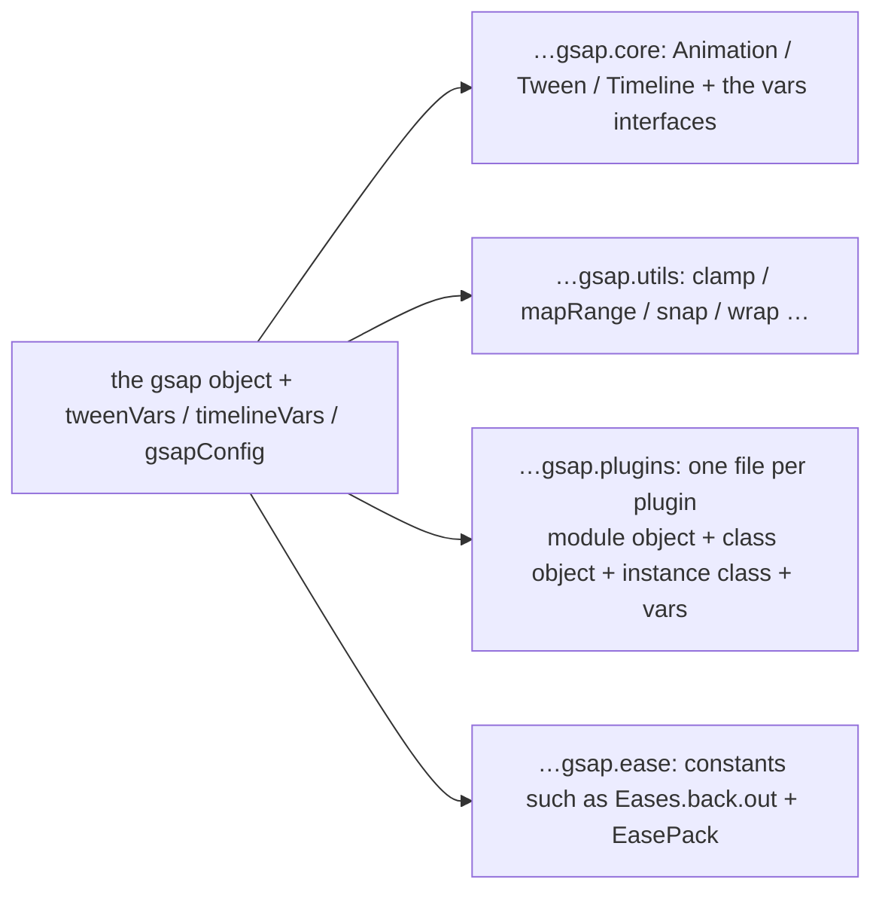

# API overview

## Package layout

| Package | Contents |
| --- | --- |
| `io.github.shijianjs.ktjs.gsap` | the `gsap` object (`G s a p`), the `GsapModule` import, and the vars builders `tweenVars` / `timelineVars` / `gsapConfig` |
| `…gsap.core` | `Animation`, `Tween`, `Timeline`, their class objects, and the vars interfaces (`TweenVars`, `TimelineVars`, `AnimationVars`, `CallbackType`, …) |
| `…gsap.utils` | `gsap.utils`: `clamp`, `mapRange`, `interpolate`, `random`, `snap`, `selector`, `toArray`, `wrap`, … |
| `…gsap.plugins` | one file per plugin: the module object, the class object `val`, the instance class and the vars interface |
| `…gsap.ease` | the easing names (`Eases.back.out`) and the `EasePack` classes |

## Conventions this wrapper follows

- A union type is one opaque interface plus one factory per branch: `TweenTarget(String)`,
  `TweenTarget(element)`, `TweenValue(120.0)`, `EaseLike("power2.out")`, `Position("+=0.5")`.
- A literal union is a `sealed external interface` with a constant object: `Eases.backOut` is the
  string `"back.out"`; tests assert every constant against the upstream string.
- Vars are objects, built with `unsafeJso` through the builders — never a hand-written JS string.
- Upstream members that take optional arguments keep them as explicit parameters: Kotlin cannot
  give an `external` member a default, so pass `null` where you do not care.
- `quickTo` returns a bare function; call it through the extension
  `QuickToFunc.invoke(value, start, relative)`.

## What is deliberately typed loosely

| Member | Kotlin type | Why |
| --- | --- | --- |
| `gsap.effects` | `EffectsMap` + `getEffect(name)` | upstream is a dynamic `Record<string, Function>` |
| `gsap.quickSetter` return | `JsAny` | upstream is an untyped callable |
| `registerEffect` / `install` argument | `JsAny` | upstream accepts an arbitrary config object |
| `TweenVars.delay` / `duration` | `Double?` | upstream allows a per-target function; the narrowed field covers the common case |

Each of these is recorded in `docs/development/technical-decisions.md`.
