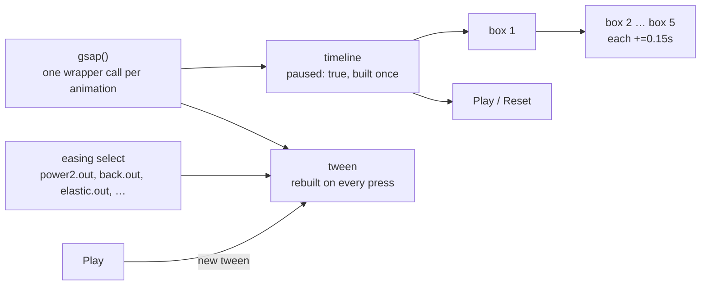

# Demo

The demo lives at [https://shijianjs.github.io/ktjs-gsap/demo/](https://shijianjs.github.io/ktjs-gsap/demo/).

The demo page runs three real animations: a timeline with five staggered boxes (each child starts
`+=0.15s` after the previous one), and one tween whose easing is taken from the select
(`power2.out`, `back.out`, `elastic.out`, `bounce.out`, `circ.out`). Both buttons re-create the
tween from scratch, so pressing Play twice shows the same motion instead of a resumed one.

The two examples share one page because they are one story: the timeline shows a wrapper call chain,
the tween shows a single call whose variables come from the page's own controls.

The language button in the page header switches between English and Simplified Chinese: every
visible string changes, not just the title.

The API reference is at [https://shijianjs.github.io/ktjs-gsap/api/](https://shijianjs.github.io/ktjs-gsap/api/), generated by Dokka from the published modules.
