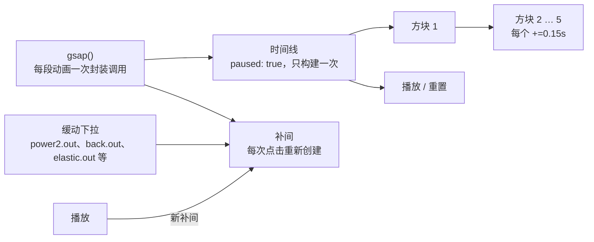

# 演示页

演示页：[https://shijianjs.github.io/ktjs-gsap/demo/](https://shijianjs.github.io/ktjs-gsap/demo/)

演示页跑三段真实动画：一条时间线带五个错开的方块（每个子项比前一个晚 `+=0.15s` 开始），
以及一条缓动由下拉框决定的补间（`power2.out`、`back.out`、`elastic.out`、`bounce.out`、`circ.out`）。
两个按钮每次都重新创建补间，连点两次看到的是同一段动画，而不是接着上一段跑。

两个示例共用一页，因为它们是一条线：时间线展示封装调用链，补间展示单次调用加页面自己的控件取参数。

页面右上角的语言按钮在英文与简体中文之间切换，切换的是页面上全部可见文案（不只是页面标题）。

API 文档在 [https://shijianjs.github.io/ktjs-gsap/api/](https://shijianjs.github.io/ktjs-gsap/api/)，由 Dokka 从已发布模块生成。
