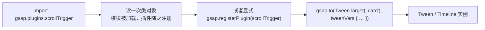

# 快速开始

## 依赖

```kotlin
kotlin {
    js {
        binaries.executable()
        browser()
    }
    sourceSets {
        jsMain.dependencies {
            implementation("io.github.shijianjs:ktjs-gsap:3.15.1-kt.1")
            // `kotlin-browser` 的 `web.*` 类型出现在公开 API 里，所以消费方要能编译到它们。
            implementation("org.jetbrains.kotlin-wrappers:kotlin-browser:2026.11.1")
        }
    }
}
```

要求 Kotlin 2.4.21 或更新版本；wrapper 输出 ESM，`es2015` 目标起可用。

## 注册插件

GSAP 在插件模块被导入时注册插件。在 Kotlin 里导入是一条声明，所以要真正用到插件的类对象 —— 那才是把模块拉进来的动作：

```kotlin
import io.github.shijianjs.ktjs.gsap.plugins.scrollTrigger
import io.github.shijianjs.ktjs.gsap.plugins.scrollTriggerVars

// 读到这个属性就足以让模块加载、插件完成注册。
val trigger = scrollTrigger.create(scrollTriggerVars { trigger = DomTarget("#hero") })
```

也支持显式注册：`gsap.registerPlugin(scrollTrigger)`。



## 第一个调用

```kotlin
import io.github.shijianjs.ktjs.gsap.gsap
import io.github.shijianjs.ktjs.gsap.tweenVars
import io.github.shijianjs.ktjs.gsap.core.TweenTarget
import io.github.shijianjs.ktjs.gsap.core.TweenValue
import io.github.shijianjs.ktjs.gsap.core.EaseLike

fun animate() {
    gsap.to(
        TweenTarget(".card"),
        tweenVars {
            x = TweenValue(120.0)
            opacity = TweenValue(1.0)
            duration = 0.8
            ease = EaseLike("power2.out")
        },
    )
}
```

vars 对象用 `tweenVars { … }` / `timelineVars { … }` 构造；数值与字符串兼可的属性类型是
`TweenValue`，上游 `number | string` 的每个分支各有一个同名工厂。

## 构建与测试

```bash
./gradlew build                     # 编译、Detekt、浏览器测试
./gradlew :ktjs-gsap:jsBrowserTest     # 只跑 wrapper 的浏览器测试
./gradlew :docs:docusaurusStart     # 文档开发服务器
./gradlew pagesSite                 # 文档在 /，演示在 /demo/，Dokka 在 /api/
```
