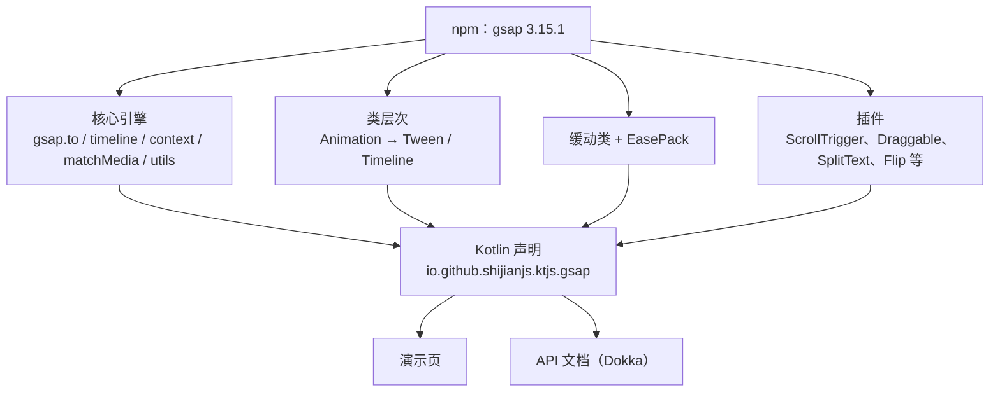

# 简介

`ktjs-gsap` 是 [GSAP](https://github.com/greensock/GSAP) 生态里 `gsap` 3.15.1 的 Kotlin/JS wrapper：上游
`.d.ts` 里的每个类型和成员都落成可被编译器检查的 `external` 声明，不靠 `dynamic` 兜底。

封装范围就是整个 `gsap` 包：核心引擎（`gsap.to`、`gsap.timeline`、`gsap.context`、`gsap.matchMedia`、`gsap.utils`）、`Animation` / `Tween` / `Timeline` 类层次、缓动类，以及全部插件 —— `ScrollTrigger`、`Observer`、`Draggable`、`Flip`、`SplitText`、`MotionPathPlugin`、`ScrollSmoother`、`InertiaPlugin`、`MorphSVGPlugin`、`DrawSVGPlugin`、`TextPlugin`、`ScrambleTextPlugin`、`ScrollToPlugin`、`PixiPlugin`、`Physics2DPlugin`、`PhysicsPropsPlugin`、`CSSRulePlugin`、`EaselPlugin`、`GSDevTools`、`CustomEase`、`CustomBounce`、`CustomWiggle` 与 `EasePack`。

## 封装了哪些包

| 模块 | Gradle 坐标 | 上游 |
| --- | --- | --- |
| `ktjs-gsap` | `io.github.shijianjs:ktjs-gsap` | `gsap` 3.15.1（单个 npm 包，插件都在这一个包里） |

一个 npm 包对应一个 Kotlin 包（`io.github.shijianjs.ktjs.gsap`）及其子包，而不是每个插件一个 Gradle 模块。

上面每条边都是一个 Kotlin 声明，不是字符串查表：上游没有的调用编译不过，没 import 的插件包也用不了。

## 许可证

wrapper 自身是 MIT。上游 `gsap` 的许可证与 wrapper 不同，商用前请读
[许可证说明](guide/license.md)。

## 接下来

- [快速开始](guide/getting-started.md) — 加依赖、写第一个调用、跑构建。
- [API 概览](guide/api-overview.md) — 包结构、类型映射约定、常用写法。
- [演示页](guide/demo.md) — 浏览器里直接看效果。
